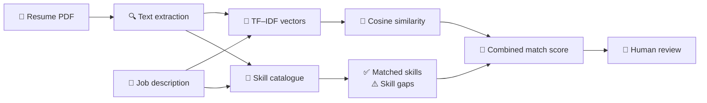

# 📄 Research Paper Draft

## A Transparent TF–IDF and Skill-Overlap Approach for Resume-to-Job Matching in a Career Development Platform

**Rachit Tripathi**  
*Affiliation:* [Add institution and department] · *Supervisor:* [Add supervisor] · *Contact:* [Add email]

[🌐 Live Application](https://ai-resume-analyzer-rachit.onrender.com/) · [💻 Source Repository](https://github.com/rachit1807/AI_RESUME_ANALYZER) · [🧪 Evaluation Plan](#-4-proposed-evaluation-method)

---

## 🚦 Publication Status

> [!IMPORTANT]
> **Working draft — not ready for journal or conference submission.**  
> The implementation described below is verified against the repository. A controlled evaluation has not yet been completed, so this manuscript makes no performance or accuracy claims. Measured results, supervisor review, author details, and venue formatting are still required.

### 🔎 At a glance

| Item | Current state |
| --- | --- |
| 🧠 Core method | TF–IDF cosine similarity + finite skill-overlap heuristic |
| 📄 Input | Text-based resume PDF + target job description |
| 🎯 Output | Completeness score, role-match estimate, matched skills and skill gaps |
| 🧪 Evaluation | Proposed; results pending |
| ⚖️ Intended use | Informational decision support with human review |
| 🚫 Not claimed | Hiring validity, employment prediction, demographic fairness or real ATS equivalence |

### 🧭 Contents

1. [Abstract](#-abstract)
2. [Introduction](#-1-introduction)
3. [Related Work](#-2-related-work)
4. [System Design](#-3-system-design)
5. [Proposed Evaluation Method](#-4-proposed-evaluation-method)
6. [Results](#-5-results)
7. [Discussion](#-6-discussion)
8. [Limitations and Responsible Use](#-7-limitations-and-responsible-use)
9. [Conclusion](#-8-conclusion)
10. [References](#-references)
11. [Submission Checklist](#-author-checklist-before-submission)

---

## 📝 Abstract

This paper presents a web-based career development platform that analyzes resume text and compares it with a supplied job description. The system extracts text from text-based PDF files, computes term-frequency–inverse-document-frequency (TF–IDF) vectors, calculates cosine similarity, and combines that similarity with overlap from a finite skills catalogue. It also provides a separate rule-based resume completeness score and identifies catalogue skills that occur in the job description but not in the resume. The platform is implemented with Flask and scikit-learn and includes candidate, recruiter, and administrator workflows. Its matching output is intended as an informational aid and does not make employment decisions. This paper describes the implementation and proposes a controlled evaluation using synthetic or consented documents and human relevance judgments. **The proposed evaluation has not yet been conducted; therefore, no accuracy or effectiveness claim is made.**

**Keywords:** resume analysis, job matching, TF–IDF, cosine similarity, skill matching, career development, human-in-the-loop

## 🎯 1. Introduction

Resumes and job descriptions are text documents with overlapping terms, but a simple keyword match may not account for how informative a term is within a document pair. The project described here offers an accessible web workflow for inspecting resume completeness and comparing resume text with a target role.

The contribution is an implemented, lightweight platform that combines document-level text similarity with a transparent skill-overlap heuristic. Unlike a learned hiring model, the system does not train on historical applicant outcomes. The output is a heuristic score that users can inspect alongside matched skills, missing catalogue skills, and resume guidance.

This work asks:

1. How does combining TF–IDF cosine similarity with catalogue-based skill overlap change ranking quality compared with TF–IDF similarity alone?
2. How consistently do the system’s rankings align with independent human judgments of resume relevance?
3. Which document or catalogue limitations affect the usefulness of the resulting scores?

These questions require an empirical evaluation. This draft reports the software design and a reproducible evaluation plan; results must be added after running that evaluation.

## 📚 2. Related Work

TF–IDF term weighting is a longstanding technique in information retrieval. Salton and Buckley examined term-weighting approaches for representing and retrieving documents. In scikit-learn, TfidfVectorizer creates normalized TF–IDF representations; when L2 normalization is used, the dot product corresponds to cosine similarity.

Resume screening also raises questions beyond text similarity. Research has examined how automated screening can reproduce or amplify unequal outcomes. Consequently, a relevance score should not be treated as a validated hiring decision. The current project does not measure demographic fairness, job performance, or employment outcomes.

## 🏗️ 3. System Design

> [!NOTE]
> The score is transparent and deterministic. It supports review; it does not make a hiring decision.

### 📄 3.1 Document extraction

The application accepts text-based PDF files and extracts page text with pdfplumber. The extracted text is passed to the analysis service. The README describes uploaded file bytes as processed in memory and discarded after the request; signed-in candidate workflows can separately save extracted text as resume history.

Image-only PDFs are not OCR processed. Extraction quality may vary with PDF structure and text layout.

### ✅ 3.2 Resume completeness heuristic

The existing ATS-style completeness score adds fixed points for detected contact details, skills, education terms, projects, experience or internship terms, and certifications, then caps the value at 100. This is a checklist heuristic, not a prediction of applicant tracking system behavior, interview probability, or candidate quality.

### 🔗 3.3 Resume-to-role matching

Let r be the extracted resume text and j the job description. The implementation vectorizes the pair using scikit-learn’s TfidfVectorizer with English stop words and calculates cosine similarity:

$
s_{\mathrm{tfidf}}(r,j)=100\times\cos\left(\mathrm{TFIDF}(r),\mathrm{TFIDF}(j)\right)
$

Let K be the finite skill catalogue, K_j the catalogue skills found in the job text, and K_r the catalogue skills found in the resume text. The matched and missing skills are:

$
M=K_j\cap K_r,\qquad G=K_j\setminus K_r
$

When K_j is non-empty, the implemented match score is:

$
s_{\mathrm{match}}=\operatorname{round}\left(0.4s_{\mathrm{tfidf}}+0.6\times100\frac{|M|}{|K_j|}\right),
$

capped at 100. If the job text contains no catalogue skill, the current code uses the TF–IDF similarity as the score. The output is accompanied by detected skills and missing-skill guidance.

This is a deterministic heuristic. It is not a trained classifier, generative model, validated ATS score, or estimate of job performance.

### 👥 3.4 Platform workflows

The Flask application includes candidate resume analysis and career tools, recruiter job and applicant workflows, batch resume ranking, and an administrator dashboard. The platform also provides resume-building and other template- or heuristic-based assistance. These product features are context for the software implementation; this study focuses on resume-to-job matching.

## 🧪 4. Proposed Evaluation Method

### 🗂️ 4.1 Data

Create a benchmark of approximately 60 resume–job pairs using either:
- fully fictional synthetic resumes and job descriptions, or
- documents collected with explicit informed consent and personal identifiers removed.

Record the generation or recruitment procedure, role categories, document counts, and inclusion criteria. Do not include real applicant documents without appropriate permission. Synthetic documents can support a controlled prototype evaluation but cannot establish performance on real applicants.

### 👩‍⚖️ 4.2 Human relevance judgments

Recruit at least three independent raters familiar with the selected role categories. Give them a written rubric and ask them to rate each resume–job pair for role relevance on a fixed scale (for example, 1–5), using only the supplied text. Define how disagreements will be summarized. Report the rubric, number and background of raters, and inter-rater agreement.

The human ratings are an evaluation reference, not a claim of hiring suitability. Avoid collecting protected characteristics for this initial study.

### ⚖️ 4.3 Systems to compare

Run the following systems on the same pairs:

1. **TF–IDF baseline:** rank by the implementation’s raw cosine similarity.
2. **Current combined heuristic:** rank by the implementation’s current match score.
3. **Human reference:** aggregate independent ratings according to the predeclared rule.

Keep preprocessing, inputs, and tie handling consistent. Save the code revision and environment versions used for the experiment.

### 📊 4.4 Metrics

Report:
- Spearman rank correlation between system scores and aggregate human relevance ratings;
- nDCG@5 or another predeclared ranking metric, using the rating scale as graded relevance;
- Precision@5 only if a relevance threshold is defined before analysis;
- results per role category and across all pairs, with uncertainty intervals where feasible.

Show the number of pairs and raters. Include a small number of anonymized or synthetic examples where the system and human rankings disagree, and analyze likely causes without exposing personal data.

### 🔁 4.5 Reproducibility

Publish the synthetic benchmark or a data-generation script, the evaluation script, the scoring configuration, and instructions for reproducing the results. Do not publish consented resume text unless participants explicitly agreed to public release. Pin software versions and record the commit hash.

## 📈 5. Results

> [!WARNING]
> **Evaluation pending.** No benchmark has yet been run for this manuscript. Populate this section only with measured results; never replace the pending values with estimates.

| System | Spearman correlation | nDCG@5 | Precision@5 (if applicable) |
| --- | ---: | ---: | ---: |
| TF–IDF baseline | [pending] | [pending] | [pending] |
| Combined heuristic | [pending] | [pending] | [pending] |

Add sample size, confidence intervals or uncertainty method, role breakdown, and error analysis after the experiment. Do not interpret blank cells as zero.

## 💬 6. Discussion

The implementation favors transparency and low operating cost: its matching logic is deterministic, inspectable, and does not require a hosted language model. Its limitations include a finite skill vocabulary, lexical rather than semantic similarity, PDF text-extraction failures, and the risk that a score may appear more authoritative than its evidence supports.

A higher score would not establish candidate quality, fairness, job performance, or validity for hiring. The application should remain a decision-support tool with human review. The current study plan does not establish demographic fairness; a separate, appropriately designed audit would be needed before making fairness claims.

## 🛡️ 7. Limitations and Responsible Use

> [!CAUTION]
> This prototype must not be used to automatically reject, shortlist, or select applicants. Every consequential decision requires qualified human review.

- The scores are heuristic and have not been validated against hiring outcomes.
- TF–IDF does not understand synonyms, context, skill proficiency, or transferable experience.
- Catalogue-based matching detects only listed skills and may miss variants or broader qualifications.
- Substring matching may produce false positives (for example, overlapping skill names); the implementation should be audited and improved before final evaluation.
- PDF extraction may omit text from image-only or unusually formatted files.
- A synthetic benchmark does not demonstrate real-world performance.
- No demographic fairness test or employment-outcome study is reported.
- The tool must not be used as an automatic rejection or selection mechanism.

## 🏁 8. Conclusion

This paper documents a career platform whose resume-to-job matching combines TF–IDF cosine similarity with a finite skill-overlap heuristic. The implementation is suitable for a transparent prototype and for a carefully scoped evaluation, but no empirical effectiveness claim can be made until the proposed benchmark is run and reported. Future work should test ranking agreement, improve skill phrase matching and document extraction, and examine fairness and usability before any consequential deployment.

## 📚 References

1. Salton, G., & Buckley, C. (1988). Term-weighting approaches in automatic text retrieval. *Information Processing & Management, 24*(5), 513–523. https://doi.org/10.1016/0306-4573(88)90021-0
2. scikit-learn developers. *TfidfVectorizer documentation*. https://scikit-learn.org/stable/modules/generated/sklearn.feature_extraction.text.TfidfVectorizer.html
3. Raghavan, M., Barocas, S., Kleinberg, J., & Levy, K. (2020). Mitigating bias in algorithmic hiring: Evaluating claims and practices. *Proceedings of the 2020 Conference on Fairness, Accountability, and Transparency*. https://doi.org/10.1145/3351095.3372828
4. Tripathi, R. *AI Resume Analyzer & Career Development Platform* (software repository). https://github.com/rachit1807/AI_RESUME_ANALYZER

## ✅ Author checklist before submission

- [ ] Confirm author list, affiliation, supervisor, and institutional requirements.
- [ ] Complete the evaluation with a documented dataset and human rating rubric.
- [ ] Audit and fix skill substring matching and reconcile differences between skill catalogues.
- [ ] Add measured results, uncertainty, error analysis, and an honest discussion.
- [ ] Obtain supervisor review and any required ethics or consent approval.
- [ ] Select a legitimate peer-reviewed venue and use its current template.
- [ ] Verify every citation and check venue policies on student work, software, and data.
- [ ] Ensure no secret keys, real resumes, or identifying personal data are included.

---

### 📌 Draft maintained with the project repository

[⬆️ Back to top](#-research-paper-draft) · [💻 View project](https://github.com/rachit1807/AI_RESUME_ANALYZER) · [🌐 Open live demo](https://ai-resume-analyzer-rachit.onrender.com/)

